<!-- ========================================== -->
<!-- 1. ANIMATED CYBERSECURITY HERO BANNER     -->
<!-- ========================================== -->

 

  <b>Cybersecurity Professional</b> specializing in <b>Vulnerability Assessment & Penetration Testing (VAPT)</b>, <b>SOC Log Analysis</b>, and <b>Active Directory Security</b>.
   
  <i>Committed to systematic threat detection, offensive security verification, and resilient defensive engineering.</i>

---

## 🛡️ Section 1 — Executive Summary & About Me

I am a cybersecurity trainee and security practitioner based in **Kozhikode, Kerala, India**, currently undergoing rigorous, hands-on professional security training at **Offenso Hackers Academy**. 

My core focus bridges offensive security validation with defensive operations:
* **Penetration Testing & Vulnerability Assessment:** Identifying, verifying, and documenting vulnerabilities across web applications, networks, and Active Directory environments following structured frameworks (**PTES**, **OWASP Top 10**).
* **SOC Operations & Threat Hunting:** Correlating security events, monitoring enterprise telemetry, and hunting for active threats with **Splunk SIEM**.
* **Traffic & Forensics Analysis:** Inspecting PCAP network traffic using **Wireshark** to pinpoint suspicious patterns, malware beacons, and Indicators of Compromise (**IOCs**).
* **Defensive Hardening & Active Directory Security:** Auditing domain architectures, identifying access misconfigurations, and validating least-privilege enforcement.
* **Security Automation:** Developing automated **Python** tools to streamline reconnaissance, scanning workflows, and assessment reporting.

> **Operational Philosophy:** *"The best way to understand defense is to master offensive mechanics responsibly. Every finding must be verified with actionable remediation."*

---

## 💼 Section 2 — Professional Experience

### **Cybersecurity Trainee**
**Offenso Hackers Academy** · *Kozhikode, Kerala, India*  
**Duration:** *January 2025 – Present*  
**Discipline:** *Penetration Testing, SOC Operations & Defensive Security Architecture*

* **Web & Network Penetration Testing:** Executed structured penetration tests across web applications, network perimeters, and internal Active Directory domains; mapped attack paths, identified critical misconfigurations, and prepared technical findings.
* **Threat Hunting & SIEM Analytics:** Operated the **Splunk SIEM** platform to ingest multi-source enterprise logs, construct search queries, correlate anomalous user behavior, and detect malicious intrusions.
* **Vulnerability Assessment & Remediation (VAPT):** Deployed industry-standard scanning tools including **Nmap**, **Nessus**, and **Burp Suite** to evaluate attack surfaces, filter false positives, and formulate concrete remediation roadmaps.
* **Incident Response Collaboration:** Practiced incident response playbooks aligned with SOC team operations to rapidly contain simulated security incidents and minimize operational exposure.
* **Security Automation with Python:** Engineered custom Python automation scripts to accelerate port discovery, target enumeration, and vulnerability triage.
* **Network Traffic & IOC Inspection:** Captured and analyzed packet streams with **Wireshark** to uncover unauthorized tunnels, anomalous protocol anomalies, and adversarial indicators of compromise.

---

## 📜 Section 3 — Verified Certifications & Education

### **Formal Education & Training**
* **Advanced Diploma in Information Security (ADIS)**  
  *Offenso Hackers Academy* · **Status:** *Pursuing (2025)*  
  *In-depth technical curriculum covering VAPT, SOC workflows, SIEM engineering, network security, Active Directory penetration testing, and ethical hacking methodologies.*
* **Higher Secondary (Commerce)**  
  *HFHSS Venappara* · **Year of Completion:** *2025*

### **Documented Certifications & Badges**
* 🛡️ **Ethical Hacking Certificate** — Issued by *ETH*
* 🧩 **Backend Developer & Reverse Engineering** — *Count Flagula CTF*
* 🐍 **Python Programming Technical Webinar** — *Participation & Code Execution*

---

## 🔬 Section 4 — Featured Cybersecurity Projects & Lab Engagements

<table width="100%">
  <tr>
    <td width="50%" valign="top">
      <h3>1. Solid State — Enterprise VAPT Assessment</h3>
      
<b>Domain:</b> Web Application &amp; Network Penetration Testing

      
A structured penetration testing and risk assessment engagement modeling realistic enterprise infrastructure against standard PTES and OWASP testing methodologies.

      <ul>
        <li><b>SQL Injection Discovery:</b> Isolated critical SQL injection vectors on authentication endpoints (<code>/login</code>) permitting unauthenticated database query execution.</li>
        <li><b>Cross-Site Scripting (Reflected):</b> Identified input validation gaps allowing malicious script execution in client browser contexts.</li>
        <li><b>Cloud Misconfiguration:</b> Discovered exposed backup storage buckets leaking sensitive configuration artifacts and sensitive parameters.</li>
        <li><b>Remediation Architecture:</b> Documented remediation guidance including parameterized queries, Content Security Policy (CSP), and IAM least-privilege enforcement.</li>
      </ul>
      
<b>Tools:</b> <code>Nmap</code> · <code>Burp Suite Pro</code> · <code>SQLMap</code> · <code>Nikto</code> · <code>Metasploit</code> · <code>CVSS v3.1</code>

    </td>
    <td width="50%" valign="top">
      <h3>2. Flappy Ghost — Android Reverse Engineering</h3>
      
<b>Domain:</b> Mobile Application Security &amp; CTF Engineering

      
An Android application developed as a specialized reverse engineering and binary analysis challenge for security researchers and CTF participants.

      <ul>
        <li><b>Anti-Tamper &amp; Obfuscation:</b> Designed an intentionally punishing mobile game challenge requiring decompilation and bytecode analysis to bypass high-score barriers (&gt;249 points).</li>
        <li><b>Flag Extraction:</b> Required analysts to decompile APK files, inspect Dalvik bytecode/Smali logic, and extract hidden verification tokens.</li>
        <li><b>Mobile Security Research:</b> Demonstrates static and dynamic analysis workflows on Android applications.</li>
      </ul>
      
<b>Tools:</b> <code>Android SDK</code> · <code>Java</code> · <code>Smali</code> · <code>APK Decompiler</code>

      
🔗 <a href="https://github.com/MUHAMMEDIJASVP/ijas-portfolio/blob/main/assets/PROJECTS/FLAPPY%20GHOST.apk"><b>Download Challenge APK</b></a> · <a href="https://muhammedijasvp.github.io/ijas-portfolio/"><b>Live Portfolio Reference</b></a>

    </td>
  </tr>
  <tr>
    <td width="50%" valign="top">
      <h3>3. SOC Threat Hunting &amp; Active Directory Labs</h3>
      
<b>Domain:</b> SIEM, Log Analytics &amp; Domain Security

      
Hands-on threat detection, event correlation, and Active Directory security laboratory implemented at Offenso Hackers Academy.

      <ul>
        <li><b>Splunk SIEM Ingestion:</b> Configured indexing pipelines for Windows Event Logs, Sysmon, and network telemetry to track lateral movement attempts.</li>
        <li><b>Wireshark Packet Analysis:</b> Reconstructed TCP streams, isolated malicious beaconing behavior, and identified DNS tunneling indicators.</li>
        <li><b>Active Directory Auditing:</b> Evaluated kerberoasting vectors, excessive user privileges, and domain controller hardening requirements.</li>
      </ul>
      
<b>Tools:</b> <code>Splunk SIEM</code> · <code>Wireshark</code> · <code>Active Directory</code> · <code>Sysmon</code> · <code>PowerShell</code>

    </td>
    <td width="50%" valign="top">
      <h3>4. NetWatch — Network Traffic Monitor</h3>
      
<b>Domain:</b> Real-Time Network &amp; Wi-Fi Telemetry

      
Frontend and telemetry interface architected for live wireless and wired network monitoring and diagnostic visibility.

      <ul>
        <li><b>Zero-Synthetic Data:</b> Strictly designed without fake or random data; interfaces directly with packet capture agents.</li>
        <li><b>Telemetry Visualization:</b> Surfaces live packet distributions, interface stats, and host connectivity status.</li>
        <li><b>Integration Ready:</b> Built with clean architecture ready for Python packet sniffers or SNMP/Socket.IO ingestion.</li>
      </ul>
      
<b>Tools:</b> <code>JavaScript</code> · <code>HTML5</code> · <code>CSS3</code> · <code>Python HTTP/Socket</code>

      
🔗 <a href="https://github.com/MUHAMMEDIJASVP"><b>Source &amp; Repository</b></a>

    </td>
  </tr>
</table>

---

## ⚡ Section 5 — Technical Skills Matrix

| Domain | Verified Tools & Technologies |
| :--- | :--- |
| **Penetration Testing & Offensive Security** | `Web & Network Penetration Testing` · `Vulnerability Assessment (VAPT)` · `Active Directory Security` · `OWASP Top 10` · `Ethical Hacking` · `Bug Bounty Research` |
| **SOC & Threat Hunting** | `Splunk SIEM` · `Threat Hunting` · `Log Analysis` · `Incident Response Playbooks` · `SOC Operations` · `MITRE ATT&CK Framework` |
| **Security Assessment Tools** | `Burp Suite` · `Nmap` · `Metasploit Framework` · `Wireshark` · `Nessus` · `Nikto` · `Gobuster` · `SQLMap` · `Hydra` · `OWASP ZAP` · `Aircrack-ng` · `Shodan` |
| **Programming & Scripting** | `Python` (Security automation & scanning) · `Bash` · `PowerShell` · `Java` (Android CTF) · `SQL` |
| **Operating Systems & Environments** | `Kali Linux` · `Linux (Ubuntu/Debian)` · `Windows 11` · `Windows Server / Active Directory` |
| **Standards & Compliance Methodologies** | `PTES (Penetration Testing Execution Standard)` · `OWASP Testing Guide` · `NIST Cybersecurity Framework` · `ISO/IEC 27001` · `CVSS v3.1` |

   
  
  
  
  
  
  
  
  
  
  

---

## 📊 Section 6 — GitHub Activity & Contribution Heatmap

### **Verified Contribution Telemetry**

*Telemetry synchronized live with GitHub user event stream for <code>@MUHAMMEDIJASVP</code> in Midnight Burgundy theme.*

---

## 📈 Section 7 — GitHub Statistics & Code Telemetry

<table border="0">
  <tr>
    <td align="center">
      
    </td>
    <td align="center">
      
    </td>
  </tr>
</table>

---

## 🌐 Section 8 — Professional Directory & Connect

Feel free to connect for penetration testing assessments, security discussions, collaborative threat research, or professional opportunities:

 

&nbsp;

&nbsp;

&nbsp;

  

| Channel | Destination / Endpoint |
| :--- | :--- |
| 🛡️ **GitHub Profile** | [`github.com/MUHAMMEDIJASVP`](https://github.com/MUHAMMEDIJASVP) |
| 👔 **LinkedIn Professional** | [`linkedin.com/in/muhammed-ijas-v-p-96596332b`](https://www.linkedin.com/in/muhammed-ijas-v-p-96596332b/) |
| 🚀 **Deployed Security Portfolio** | [`muhammedijasvp.github.io/ijas-portfolio`](https://muhammedijasvp.github.io/ijas-portfolio/) |
| 📬 **Inquiries & Encrypted Comms** | [`muhammedijasvp69@gmail.com`](mailto:muhammedijasvp69@gmail.com) |
| 📍 **Base of Operations** | `Kozhikode, Kerala, India (11.2588° N, 75.7804° E)` |

---

<!-- ========================================== -->
<!-- 10. ANIMATED CYBERSECURITY FOOTER SVG      -->
<!-- ========================================== -->

  

